# WargaKu RT

WargaKu RT is a web app for neighborhood (RT) administration. Residents can request official letters online and track each request's status, and RT administrators review requests, update their status, generate the letter as a PDF and publish announcements. The user interface is in Indonesian.

**Live demo:** https://wargaku-rt.vercel.app/

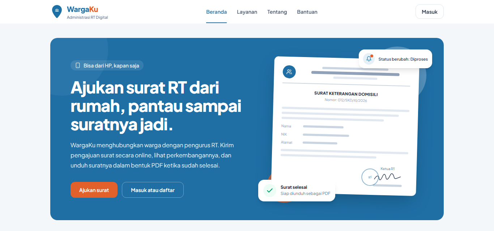

## Features

**Residents (`user` role)**
- Register and log in with email and password (Supabase Auth). Registration collects full name, a 16-digit NIK and address.
- Submit a letter request through a validated, three-step form with the letter type picked from cards. Five letter types are available: domicile (*domisili*), business (*usaha*), low-income (*tidak mampu*), RT cover letter (*pengantar RT*) and general (*umum*).
- Track requests by status (*Menunggu*, *Diproses*, *Selesai*, *Ditolak*), with search, status filters with counts, and a step-by-step progress tracker on each request.
- Resident dashboard with a greeting, the progress of the latest request, request and notification counts, recent requests and the latest announcements.
- See the rejection reason and resubmit a rejected request with the form pre-filled.
- Download the finished letter as a PDF.
- Read announcements from the RT.
- Get in-app notifications when a request's status changes or a new announcement is posted, and mark them as read.

**Administrators (`admin` role)**
- Admin dashboard showing request counts per status, the latest requests and an activity timeline.
- Change a request's status, give a reason when rejecting, or delete a request.
- Preview the letter and generate an A4 PDF, numbered automatically, when a request is completed.
- Create announcements in one of four categories, with a live preview. Each one also creates a notification for every resident.

**Live updates**
- Request lists, announcements and notifications refresh in real time through Supabase Realtime (`postgres_changes` subscriptions).

**Interface**
- Responsive layout for phones, tablets and desktops: a slide-in menu on small screens, finger-sized buttons and form fields, and dialogs that open as bottom sheets on phones.
- Floating "liquid glass" navigation bar (translucent, blurred background), with a solid fallback for browsers without `backdrop-filter` support.
- Navigation changes with the user's role: visitors, residents and administrators each see their own menu.
- A help page with frequently asked questions and a contact form that opens the user's email app.

## Tech Stack

| Area | Technology |
| --- | --- |
| Framework | Next.js 16.2 (App Router), React 19.2, TypeScript |
| Styling | Tailwind CSS 4, Plus Jakarta Sans (`next/font`) |
| Backend | Supabase: Auth, Postgres, Realtime (`@supabase/supabase-js` 2) |
| Validation | Zod 4 |
| PDF | Built-in generator in `lib/pdf` (no external PDF library) |
| Deployment | Vercel |

## Screenshots

Screenshots of the running app. The logged-in pages show **fictional sample data**.

**Resident dashboard:** greeting, progress of the latest request, counts, requests and announcements.

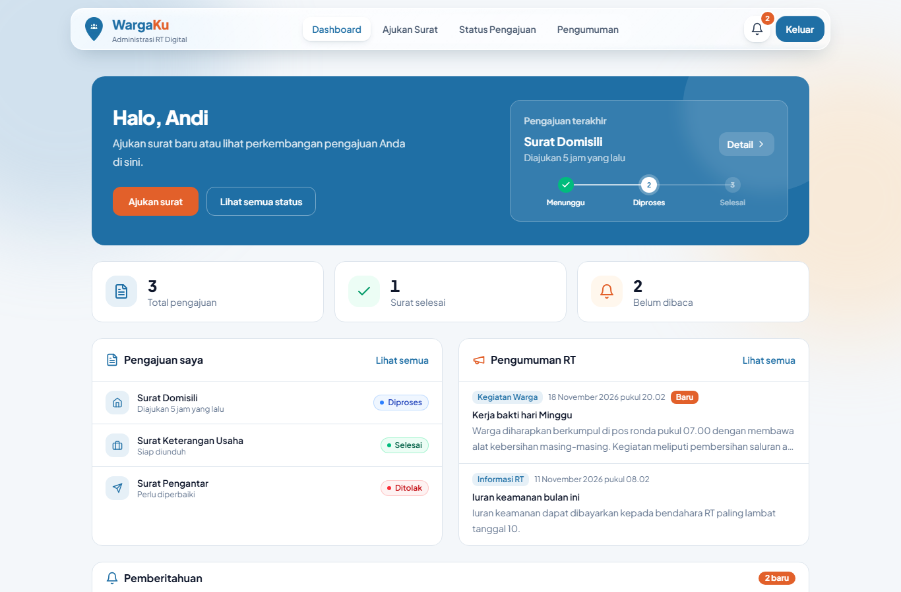

**Request status:** filter tabs with counts, and a progress tracker on every request. Rejected requests show the administrator's note and a resubmit button.

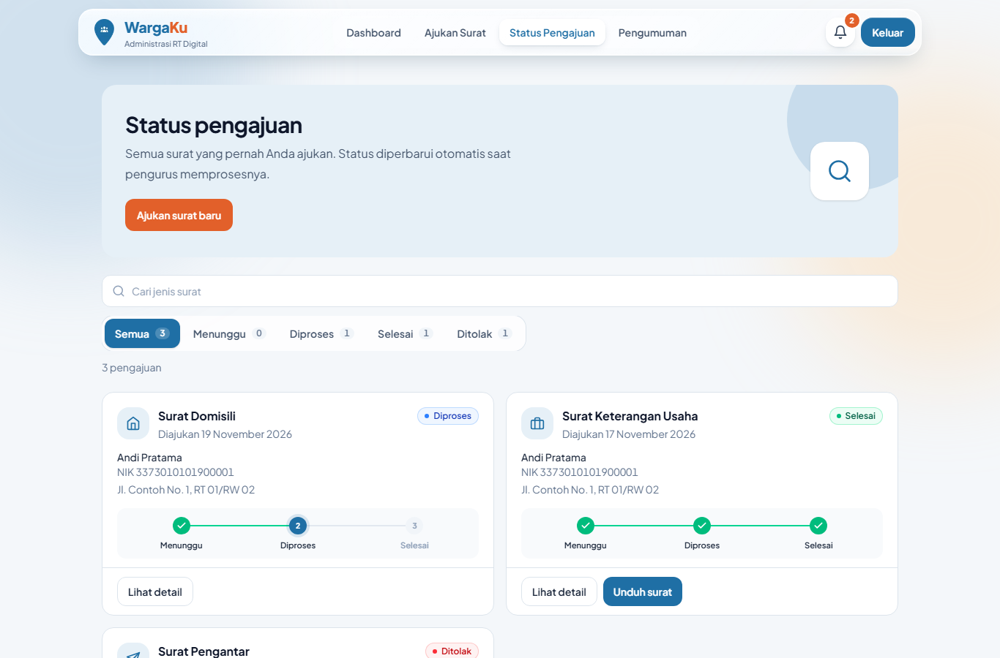

**Submit a letter:** the letter type is picked from cards, the form is split into three steps, and personal data is pre-filled from the account.

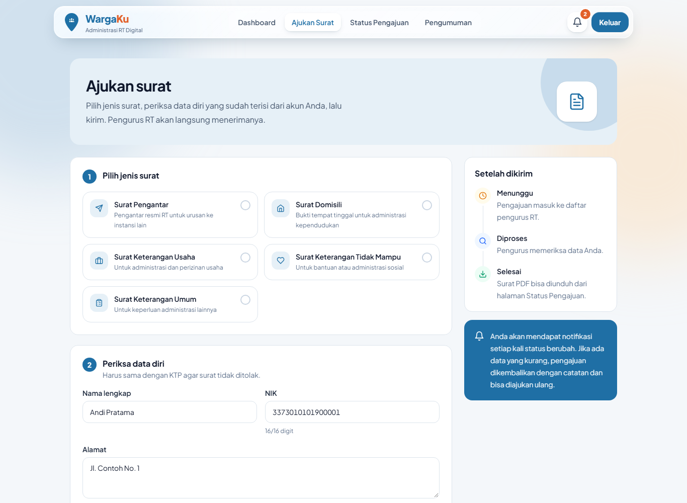

**Announcements:** residents read announcements with color-coded categories; administrators write them with a live preview of what residents will see.

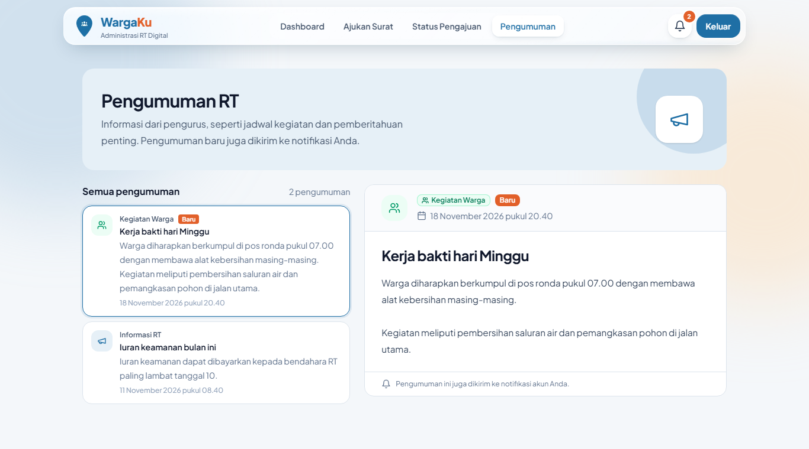

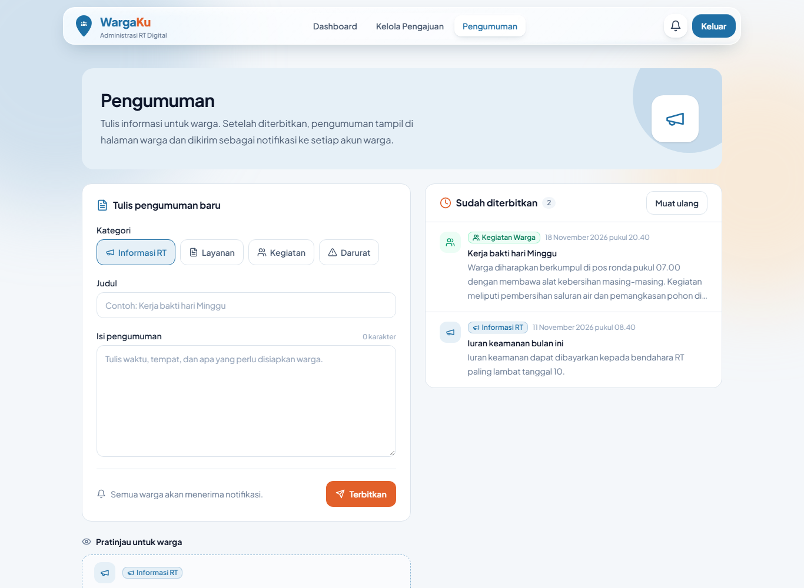

**Admin dashboard:** requests per status, recent requests and an activity timeline.

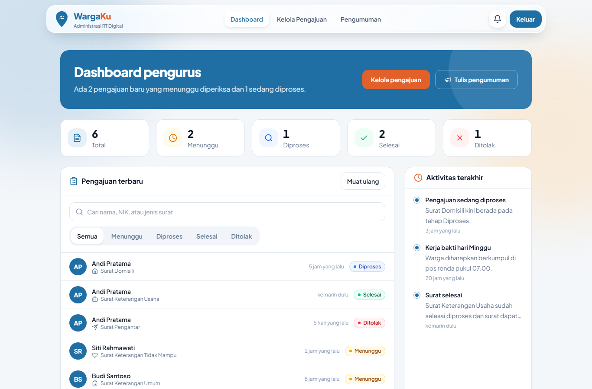

| Dashboard (phone) | Home (phone) | Help (phone) |
| --- | --- | --- |
| 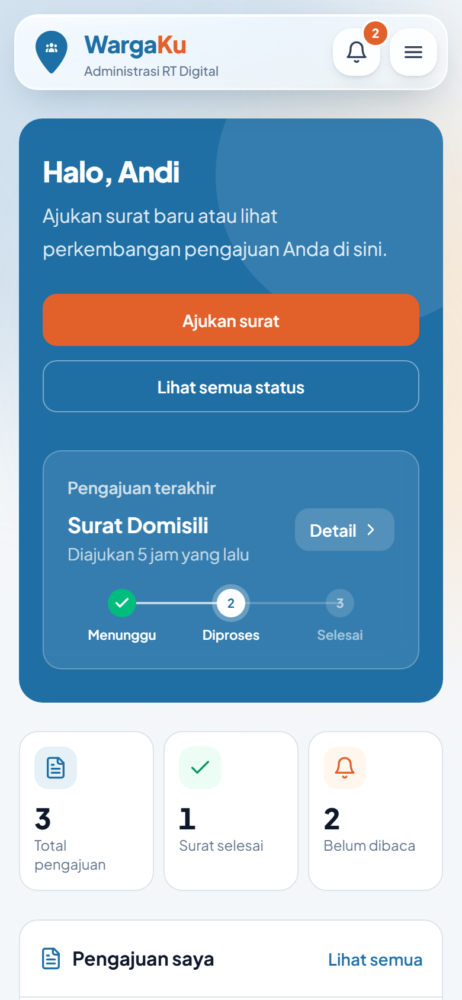 | 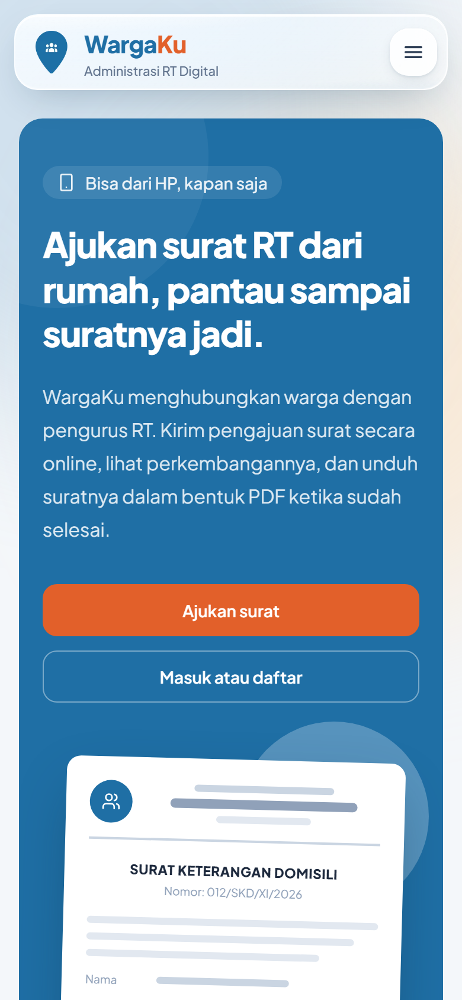 | 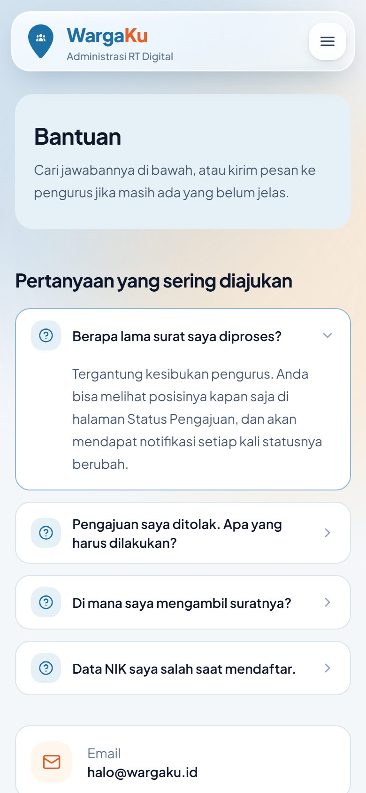 |

<details>
<summary>Sign-in page (desktop)</summary>

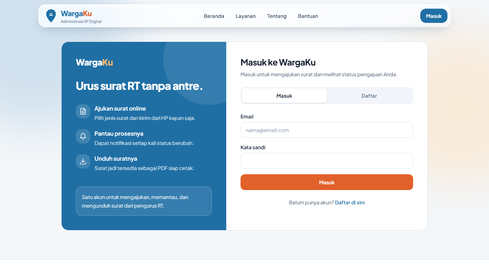

</details>

## Design

The UI was designed in Figma before development, and the app uses the same colors and typeface. The images below are **Figma hi-fi designs, not screenshots of the running app**.

| Dashboard | Submit a letter | Request status |
| --- | --- | --- |
|  |  |  |

Figma file: [WargaKu RT design](https://www.figma.com/design/GfDeMgNBKQOoHTpYPSFVKx/Tugas-4?node-id=28-1030)

## Project Structure

```
app/          Routes (App Router): /, /login, /dashboard, /ajukan-surat, /status,
              /pengumuman, /admin, /admin/pengumuman, /about, /services, /contact,
              plus the /api/services route handler; globals.css holds the color
              tokens and shared form styles
components/   Navbar, auth provider, dashboards, letter preview, toasts;
              components/ui has the shared Button, Card, Icon, PageHeader,
              StatusBadge, StatusTracker, LetterIcon, CategoryChip,
              EmptyState and PageSkeleton
docs/         README screenshots
hooks/        useAuth, useToast
lib/          Supabase client and types, auth/profile helpers, announcements,
              notifications, NIK validation, PDF generation (lib/pdf)
constants/    Letter template metadata
public/       Logo and Figma design images
proxy.ts      Next.js proxy (middleware) that redirects logged-out users from
              /ajukan-surat and /status to /login
```

## Getting Started

**Requirements:** Node.js and npm, plus a Supabase project.

1. Install dependencies:
   ```bash
   npm ci
   ```
2. Copy `.env.example` to `.env.local` and fill in your Supabase project values:
   ```bash
   NEXT_PUBLIC_SUPABASE_URL=
   NEXT_PUBLIC_SUPABASE_ANON_KEY=
   ```
3. Start the development server:
   ```bash
   npm run dev
   ```
   Then open http://localhost:3000.

Other scripts: `npm run build`, `npm run start`, `npm run lint`.

## Database

The app expects these tables in the Supabase `public` schema. The list comes from the TypeScript types in `lib/supabaseClient.ts`:

| Table | Purpose |
| --- | --- |
| `profiles` | User profile: full name, NIK, address, email, role (`admin` or `user`) |
| `pengajuan_surat` | Letter requests: applicant data, letter type, status, rejection reason, letter file name, link to the original request when resubmitted |
| `notifications` | Per-user notifications with type, message, metadata and read flag |
| `announcements` | Announcements with title, category, content and author |

> **Note:** The SQL schema, Row Level Security (RLS) policies and Realtime configuration are not in this repository. You have to set them up in your own Supabase project.

## Project Context

WargaKu RT was built as a team project during the VINIX7 Independent Study program (Studi Independen), February to June 2026.

## Contributions

My contributions to this project:

- Designed the user flow, wireframes and hi-fi designs in Figma
- Developed the app with Next.js, Tailwind CSS and Supabase
- Authentication
- Online letter request submission
- Admin dashboard
- Request status management
- Announcements
- Team collaboration with Git and GitHub
- Deployment on Vercel
